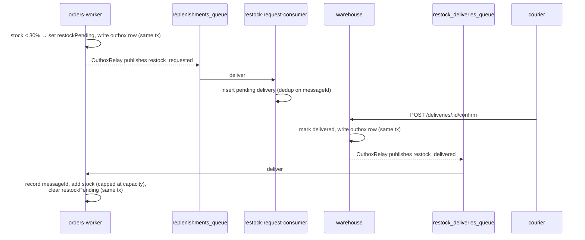

# Dogged · RabbitMQ

A multi-service NestJS system for a hot dog vendor, built to study how a message broker makes services more reliable. It continues the *Dogged* project, where every service talked over REST. Here REST stays only where a caller needs an answer straight away (reading the menu). Everything else goes through **RabbitMQ**:

- **Reliability.** An accepted order is never lost, even if the service that stores it is down. Messages wait in a durable queue until a consumer can handle them.
- **Background work.** The customer doesn't wait while stock is updated or a restock is arranged. Workers do that work after the response has been sent.

## Contents

- [Quick start](#quick-start)
- [Architecture](#architecture)
- [How the flows work](#how-the-flows-work)
- [Reliability guarantees](#reliability-guarantees)

## Quick start

Requirements: Docker with Compose v2. Node.js is only needed if you want to run services or tests outside Docker.

```bash
cp .env.example .env
docker compose up --build
```

On first boot Postgres creates the `orders_management` and `warehouse` databases. `orders-management` and `warehouse` then run their migrations, which seed the menu and give every terminal in `KNOWN_TERMINAL_IDS` a stock of 50 per item.

| What | URL |
|---|---|
| Terminal API (Swagger) | http://localhost:3000/docs |
| Orders Management API (Swagger) | http://localhost:3001/docs |
| Warehouse API (Swagger) | http://localhost:3002/docs |
| RabbitMQ management UI | http://localhost:15672 (`guest` / `guest`) |
| Grafana | http://localhost:9000 (`admin` / `admin` on first login) |
| Prometheus | http://localhost:9090 |
| Alertmanager | http://localhost:9093 |

Stop everything with `docker compose down`. Add `-v` to also delete the data volumes and start fresh.

## Architecture

### Services

| Service | Kind | Role | Database |
|---|---|---|---|
| `terminal` (`:3000`) | HTTP | The vendor's cart, standing in for a client app. Serves the menu and accepts orders. | Local SQLite file (menu cache) |
| `orders-management` (`:3001`) | HTTP | Menu catalog. Owns the `orders_management` schema and runs its migrations. | `orders_management` |
| `orders-worker` (×2) | RabbitMQ consumer | Records orders, reserves stock, requests restocks, and applies confirmed deliveries. | `orders_management` |
| `restock-request-consumer` (×2) | RabbitMQ consumer | Turns restock requests into pending deliveries. | `warehouse` |
| `warehouse` (`:3002`) | HTTP | Lists deliveries and lets a courier confirm them. Owns the `warehouse` schema. | `warehouse` |

The workers have no business endpoints. Their HTTP port only serves `/metrics`, on `3004` for `orders-worker` and `3005` for `restock-request-consumer`. They share a database with the service that owns the schema and never run migrations themselves, because two replicas migrating at once would race.

### Queues

All queues are durable **quorum queues**. Each main queue has a dead-letter queue (DLQ) that collects messages that can't be processed.

| Queue | Pattern | Producer | Consumer | DLQ |
|---|---|---|---|---|
| `orders_queue` | `order.place` | `terminal` | `orders-worker` | `orders_queue.dlq` |
| `replenishments_queue` | `replenishment.restock_requested` | `orders-worker` (outbox) | `restock-request-consumer` | `replenishments_queue.dlq` |
| `restock_deliveries_queue` | `replenishment.restock_delivered` | `warehouse` (outbox) | `orders-worker` | `restock_deliveries_queue.dlq` |

Queue names, options and message classes live in `libs/contracts`, and producers and consumers both import them from there. That matters because RabbitMQ refuses to declare a queue a second time with different arguments (`PRECONDITION_FAILED`).

### Shared libraries

| Library | Purpose |
|---|---|
| `libs/contracts` | Message patterns, payload classes (validated with `class-validator`), queue names and options |
| `libs/outbox` | Transactional outbox: `OutboxService.enqueue()` plus a background `OutboxRelay` that publishes |
| `libs/orders-db`, `libs/warehouse-db` | TypeORM entities shared by each HTTP service and its worker |
| `libs/resilience` | Retry, circuit breaker and timeout policies built on [cockatiel](https://github.com/connor4312/cockatiel) |
| `libs/metrics` | `/metrics` endpoint, HTTP metrics and resilience metrics for Prometheus |
| `libs/utils` | Small helpers, such as `deliveryAttempt()` (reads `x-delivery-count`) and validation error formatting |

## How the flows work

### Placing an order

1. `terminal` validates the body, adds its own `TERMINAL_ID` and publishes the message. The publish runs through a retry and circuit breaker policy. If the broker can't be reached it answers `503`, and the customer can safely retry with the same `idempotencyKey`.
2. `202 Accepted` means *the broker has the order*, not that it has been stored yet. Storing it happens in the background.
3. `orders-worker` validates the payload and checks that every item is on the menu. Then, in a single transaction, it:
   - inserts the order, using `idempotencyKey` as the primary key,
   - decrements stock atomically, never going below 0. If a terminal didn't have enough, the order is still accepted and flagged with `inventoryIssue`,
   - schedules a restock if stock fell below **30% of capacity** (see below).

### Restocking a terminal



- `restockPending` is claimed with a conditional `UPDATE`, so a terminal has at most one restock in flight per item, no matter how many orders arrive at once.
- The warehouse treats its own stock as infinite. Every request becomes a delivery that fills the terminal back up to capacity.
- The courier is simulated by calling `POST /deliveries/:id/confirm`. Confirming is idempotent: a second confirm doesn't publish another event.

## Reliability guarantees

### Transactional outbox

Services that write to a database *and* publish a message never publish directly. If they did, a crash between the two steps would either lose the message or announce a change that was rolled back. Instead:

1. The business change and an `outbox_message` row are written in **the same transaction**, through `OutboxService.enqueue(manager, pattern, payload)`.
2. `OutboxRelay` polls every 2 seconds, takes up to 50 unpublished rows with `FOR UPDATE SKIP LOCKED` (so replicas don't pick the same rows), publishes them and sets `publishedAt`.
3. A failed publish increments `attempts` and records `lastError`. A row stops being retried after 20 attempts.

This gives **at-least-once** delivery: a message can be published twice if the relay crashes after publishing but before marking the row. That's why every consumer is idempotent.

### Idempotent consumers

| Consumer | How it detects a repeat |
|---|---|
| `order.place` | The order's primary key is the client's `idempotencyKey`. A unique violation means "already placed", so the message is acked and ignored. |
| `restock_requested` | `deliveries.restockRequestId` is unique (it holds the outbox `messageId`). `INSERT … ON CONFLICT DO NOTHING` creates nothing the second time. |
| `restock_delivered` | Adding stock isn't idempotent, so `orders-worker` keeps an **inbox** (`processed_messages`). The `messageId` is inserted in the same transaction as the stock change. If it's already there, the message is skipped. |

### Acknowledgements, retries and the DLQ

Consumers use manual acks (`noAck: false`, `prefetchCount: 10`). Every handler follows the same rules:

| Outcome | Action | Result |
|---|---|---|
| Success, or a duplicate | `ack` | Message removed |
| Invalid payload, or a business rejection (unknown menu item, no stock row) | `nack` without requeue | Straight to the DLQ: retrying can't fix it |
| Unexpected error (database down, timeout, …) | `reject` with requeue | Delivered again |

Quorum queues count redeliveries in `x-delivery-count`. After **5 requeues (6 attempts in total)**, `x-delivery-limit` makes RabbitMQ dead-letter the message instead of looping forever. The final attempt is logged as an error together with its stack trace.

DLQs are declared explicitly in each service's `main.ts` before the app starts, because declaring the main queue doesn't create its DLQ, and a dead letter with nowhere to go is silently dropped.
